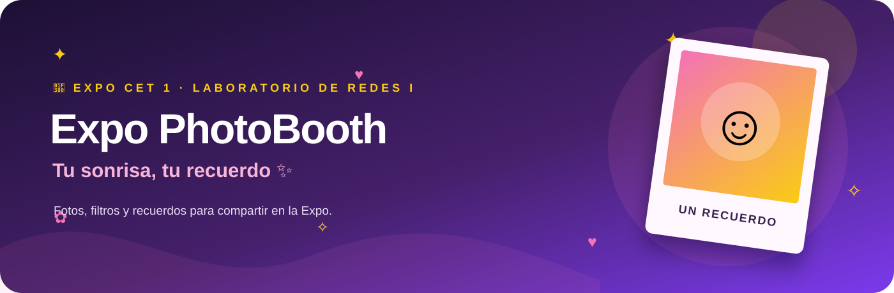

<div align="center">



### 🎀✨ Tu sonrisa, tu recuerdo ✨🎀

**Una cabina de fotos para celebrar Expo CET 1 · Laboratorio de Redes I**

💖 📸 🌸 💫 🌸 📸 💖

[](https://react.dev/)
[](https://vite.dev/)
[](https://nodejs.org/)
[](#-qué-podés-hacer)

</div>

---

## 💌 La idea

Un rinconcito para posar, jugar con filtros y llevarse una foto de la Expo. La cabina corre en una computadora con Windows y webcam; las imágenes se guardan ahí mismo y se pueden descargar desde el celular escaneando un QR. ✨

## 💖 Qué podés hacer

| 🌷 Momento | ✨ Qué pasa |
|:--|:--|
| Elegir tu estilo | Foto individual o una tira con cuatro poses. |
| Probar un look | Sin filtro, blanco y negro, sepia o colores Expo, con vista previa en vivo. |
| Inspirarte | Girá la ruleta para recibir una idea divertida de pose antes de la foto. |
| Preparar la pose | Cuenta regresiva de 3 segundos, con opción de cancelar. |
| Guardar el recuerdo | JPG con marco y título **EXPO CET 1 - LABORATORIO DE REDES I**. |
| Compartir la magia | QR a una galería local para abrir y descargar las fotos desde el celular. |

## 🎨 Paleta de la cabina

<div align="center">

🟪 `#1C1034` Violeta noche　 🟣 `#7C3AED` Violeta　 💗 `#F472B6` Rosa　 💛 `#FACC15` Amarillo　 🤍 Blanco

</div>

## 🚀 Cómo ponerla en marcha

### En Windows

1. Instalá [Node.js LTS](https://nodejs.org/) si todavía no está instalado.
2. Abrí `INICIAR.bat` con doble clic.
3. Permití el acceso a la webcam y, si Windows lo pregunta, habilitá la red privada.
4. Dejá abierta la ventana de Expo PhotoBooth mientras funciona la cabina.

La primera vez se descargan las dependencias, así que hace falta internet durante la instalación.

### Desde una terminal

```bash
npm install
npm run dev
```

## 📱 Compartir con el QR

Conectá la computadora y el celular a la **misma Wi-Fi**. Al terminar una foto, escaneá el QR y descargá las imágenes desde la galería. Los JPG se guardan en `data/photos` en la computadora de la cabina.

> 🔒 La galería funciona dentro de la red local y no tiene contraseña en esta versión. Usala en la Wi-Fi privada del evento, no en una red pública.

## 🧁 Tecnologías

**React + Vite** para la experiencia visual · **Node.js** para el servidor local · **Canvas** para componer las fotos · **QRCode** para crear el código de la galería.

Las imágenes se guardan como archivos JPG. FastAPI y SQLite se contemplaron como posibles pasos futuros, pero no forman parte de este MVP.

## 📂 Mirá también

- [📖 Informe completo del proyecto](INFORME_PROYECTO.md)
- [📸 Pantallas y estilos](src/App.jsx)
- [🎀 El banner del proyecto](docs/banner.svg)

## 🛠️ Antes del gran día

- Probar cámara, iluminación y encuadre en el equipo definitivo.
- Escanear el QR y probar descargas con celulares conectados a la Wi-Fi del evento.
- Acordar cuándo se borrarán las fotos guardadas después de la Expo.

<div align="center">

### Hecho con 💖, muchas sonrisas y un poquito de ✨

**Expo CET 1 · Laboratorio de Redes I · 2026**

</div>

